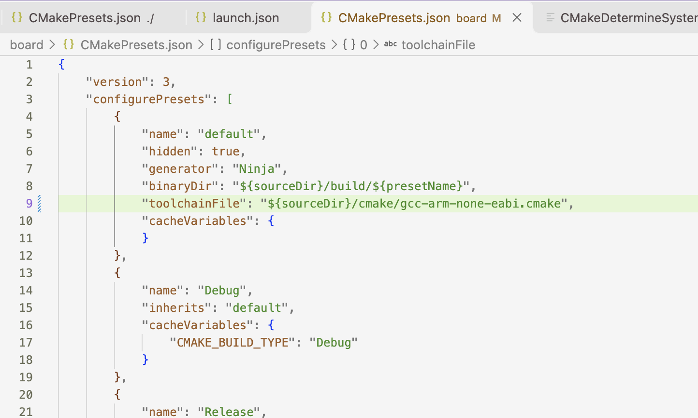

# 学习记录

## 第一次

### ① 引入了 CMake 和目录分离（为什么需要 settings.json）

这个工程有 board、bsp、modules 等一堆平级目录。源代码分散在 bsp/src，头文件在 bsp/include。VS Code 的根目录是 rm27_training_framework_hw，但 CMake 的真正根目录其实是 board/。
如果没有 settings.json 里的 "cmake.sourceDirectory": "${workspaceFolder}/board"，VS Code 的 CMake Tools 插件就不知道去哪里找 CMakeLists.txt，配置会直接失败。

### ② 复杂的头文件路径（为什么需要 c_cpp_properties.json）
由于文件没有全都放在一起，如果不告诉 C/C++ 插件具体路径，插件的暴力扫描就会失效。同时，因为你在写 .cpp（C++），需要区分标准库（如 <cstring> 和 uint8_t），必须显式告知插件使用 ARM 交叉编译器（arm-none-eabi-gcc）来解析，而不是 Mac 默认的 Clang，否则就会像之前那样满屏红波浪线。
c_cpp_properties.json 让你告别了“瞎猜”，直接去读 CMake 生成的 compile_commands.json。这是最准确的头文件包含路径记录，是根治红波浪线的终极解药。

### ③ CMake 编译系统（为什么需要 compile_commands.json）
这在以前你的单个工程里是完全不存在的。CMake 在配置时，会把所有的编译参数、宏定义（比如 CAN_DEBUG）、头文件搜索路径，打包成一个名为 compile_commands.json 的数据库。VS Code 只有读取了这个文件，才能完全模拟出底层 arm-none-eabi-gcc 编译时的环境。

### ④ 调试配置的变化（launch.json）
以前你可能只需要在 launch.json 里随便写一个 "executable": "xxx.elf"。但在 CMake 工程里，编译产物被放在了 board/build/Debug/ 目录下，并且名字变成了 board.elf 或 rm27_training_framework_hw.elf。如果 launch.json 的路径不跟着变，OpenOCD 就会找不到文件报错（你刚才遇到的 pgrep 失败）。

## 第二次：数据架构

### 应用与业务层 (threads/)

负责：跑 FreeRTOS 任务，写 PID 控制逻辑。
动作：任务里调用 IMU.Read() 和 Motor.SetCurrent()。

### 设备驱动层 (modules/)

负责：具体外设（BMI088、DJIMotor）的协议逻辑。比如怎么解析 BMI088 的 6 字节数据，怎么打包大疆电机的 CAN 报文。
动作：调用 BSP_CAN_Transmit() 发送报文，调用 BSP_SPI_TransmitReceive() 读取 IMU。

### 板级支持层 (bsp/)

负责：外设底层配置（过滤器、中断、DMA）和硬件接口封装。
动作：调用 HAL 库函数 HAL_CAN_AddTxMessage()、HAL_SPI_TransmitReceive()。

### 硬件抽象层 (board/)

负责：CubeMX 生成的初始化代码。管时钟、管 GPIO 引脚、管外设寄存器的基础参数。
动作：提供 hspi1、hcan1 等句柄。

### 算法工具层 (libs/)

（横向支撑）提供 PID.Calc()、CRC_Check() 等纯数学和工具函数，被上层任意调用。

## 第三次

		//"toolchainFile": "${sourceDir}/cmake/gcc-arm-none-eabi.cmake",
		//"toolchainFile": "${sourceDir}/board/cmake/gcc-arm-none-eabi.cmake",***错误的，相当于打开了 board 两次
## 第四次

### 电机控制线程中：

#### motor.AliveCheck()设置了控制模式才能动，每 10 毫秒检查一次状态是否掉线；

#### 以及循环setOutput()//根据 pid 计算结果反馈设置currentSet

#### 循环sendControlData()//对各个电机的 currentSet 进行最大限制，数据移位打包操作，最后发送

#### 感天动地电机终于转了（把tx_thread_sleep(1)移到 while前面了，可能给 can 初始化 以及其他线程一些时间？）

